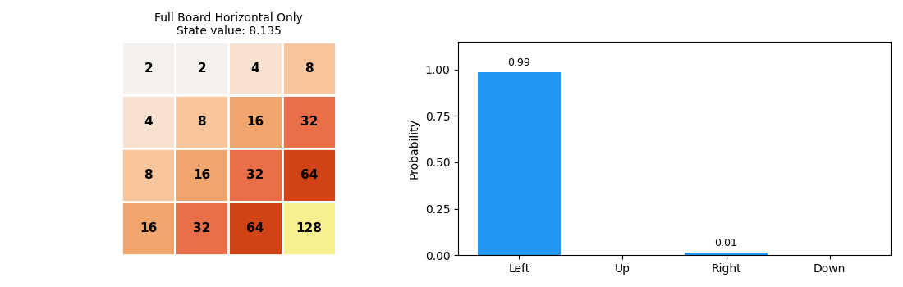
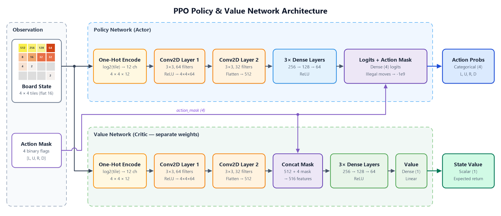
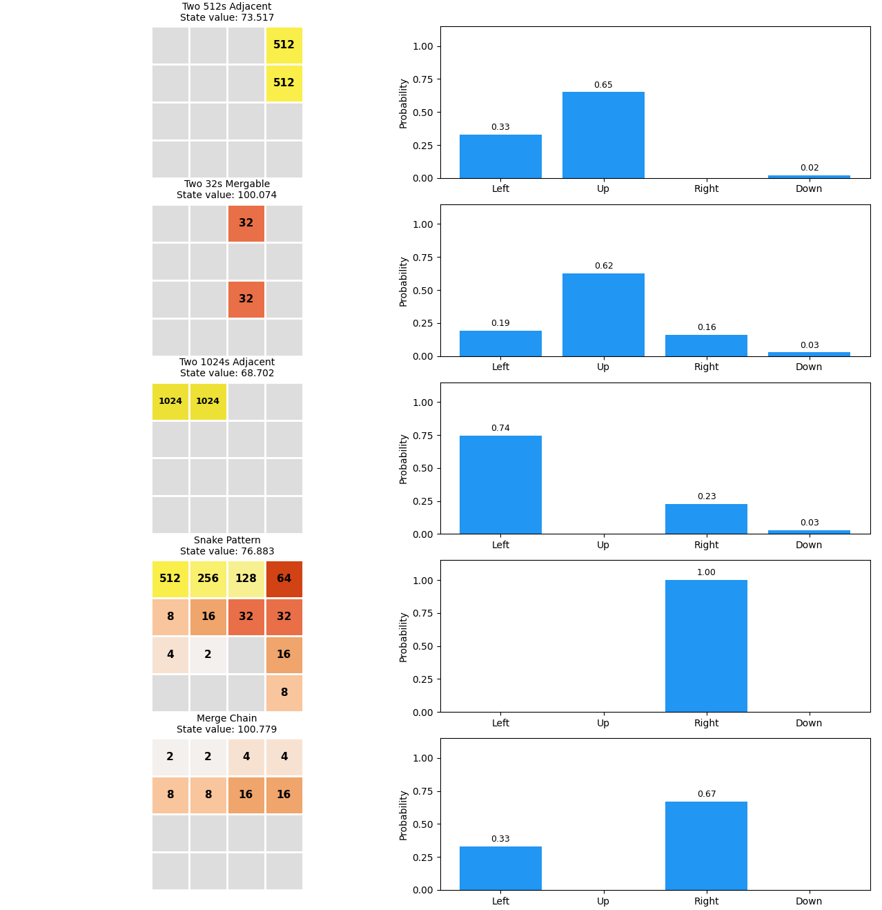
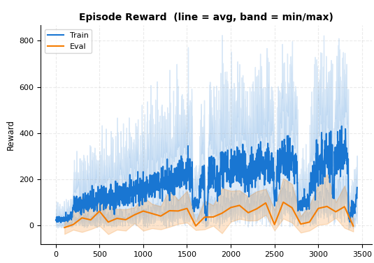
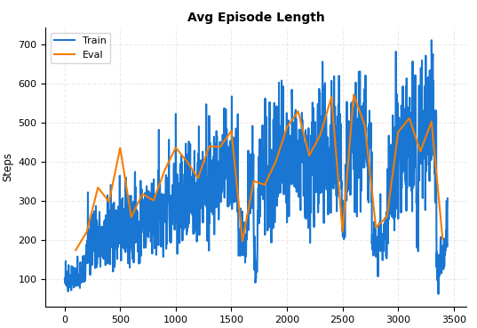
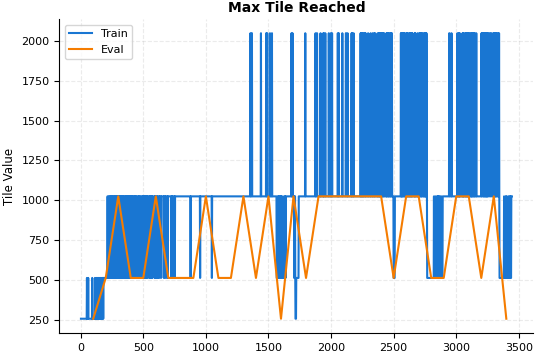
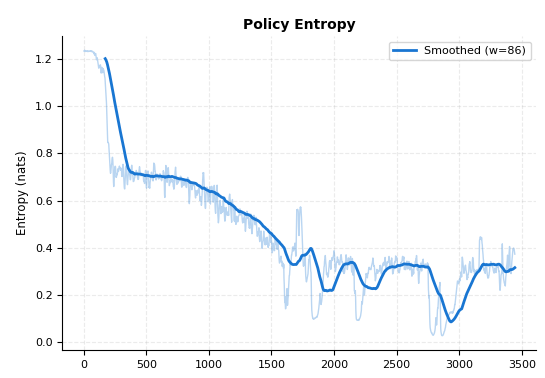
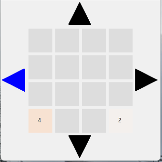
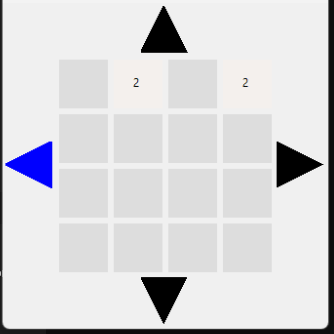
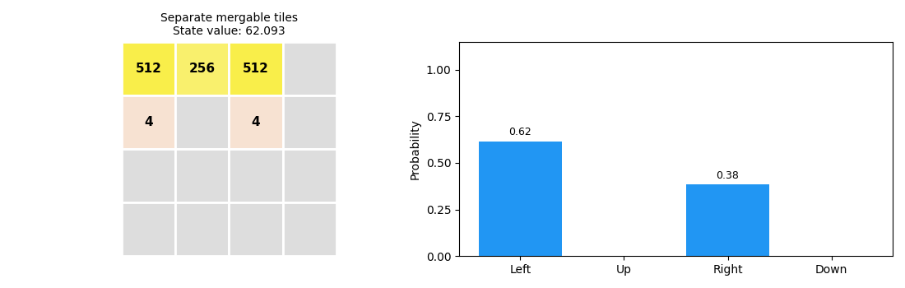

## Background

Back in 2018, I wrote a [post about training an AI to play 2048]() using a custom neural network and a genetic algorithm that I built from scratch. Those agents topped out around the 512 tile mark and never came close to actually winning the game. I knew that my implementation had some pretty big limitations since I wrote it all myself, but at the time I cared more about learning how those systems worked than getting the best possible score.

At the end of that post, I mentioned wanting to revisit 2048 someday with established tools like [TensorFlow](https://www.tensorflow.org/). A few years ago I actually started doing just that using [TF-Agents](https://www.tensorflow.org/agents), Google's reinforcement learning library built on top of TensorFlow, to train an agent with a proper RL algorithm instead of a genetic approach. However, I hit a wall when I couldn't get training to make any real progress, and the project ended up sitting on the shelf for a few years.

With all the recent advancements in AI coding tools, I decided to dust this codebase off and see if [Claude](https://claude.ai/) could help me jumpstart it again. I was particularly interested in trying Claude out since I didn't have access to Anthropic models at my day job for... _reasons_... and I wanted to see what the hype was about. With some assistance from Claude I was able to kickstart the project again and get a proper RL algorithm running. Though getting the agent to actually learn well still took a lot more effort than I expected.

## My First Attempt: Buggy DQN

While the genetic algorithm from my first attempt is a form of optimization, it isn't really [reinforcement learning](https://en.wikipedia.org/wiki/Reinforcement_learning). It treats the entire game as a black box: play a full game, compute a single score at the end, and use that score to decide which agents survive into the next generation. There is no gradient signal and no credit assignment (a fancy way of saying the agent never learns which specific moves actually helped or hurt), just one final number telling it whether the round went well overall.

Reinforcement learning fixes this by having the agent interact with the game one step at a time. Because it receives a reward after each move, it can use [gradient descent](https://en.wikipedia.org/wiki/Gradient_descent) to connect specific actions to their longer-term consequences. That makes it far more data-efficient than the genetic approach and (theoretically) gives it a way to pick up strategies that require thinking a few moves ahead.

When I first started my implementation with TF-Agents, I wrapped my 2048 game logic in a `PyEnvironment` interface and built the training loop around a [Deep Q-Network (DQN)](https://en.wikipedia.org/wiki/Q-learning#Deep_Q-learning). DQN is a popular off-policy RL algorithm that learns to estimate the expected future reward for each action in a given state. Unfortunately, it never made any real progress during training, which is what originally caused me to set the project aside.

When I picked the repo back up, my first task for Claude was figuring out why that existing DQN setup wasn't going anywhere. This initial code review ended up being its most valuable contribution of the whole project. It caught several bugs in my environment and reward setup that were sabotaging training:

- Invalid moves weren't handled properly. An action that didn't move any tiles still spawned a new random tile and still returned a reward, so the agent could spam an invalid direction and fill up the board while being told it was doing fine.
- Winning was punished the same as losing. I misconfigured the game-over logic so that reaching 2048 and filling up the board both ended the episode with a reward of -1, meaning the agent had literally no signal that winning was good!
- The per-step reward was a constant value of 1 regardless of what the move accomplished, which taught the agent to stall and maximize episode length rather than merge tiles.
- Episodes started on an empty board instead of with the standard two starting tiles, so the first observation of every game was a state that would never actually happen.
- Raw tile values (2, 4, 8, etc.) were fed straight into a dense layer with a [sigmoid activation](https://en.wikipedia.org/wiki/Sigmoid_function), which saturated quickly. Since `sigmoid(64)` and `sigmoid(2048)` both evaluate to 1.0, boards with medium tiles and boards with huge tiles looked nearly identical to the network.

Claude also flagged a few issues with how I had configured DQN itself: the replay buffer was way too small (it only held ~four iterations of data), the soft target-network update was so slow that the network was practically frozen, and the exploration rate was fixed at 0.1 with no decay schedule.

None of these were obvious bugs to an ML novice like myself since the program still ran. Training just didn't make any progress and I couldn't tell why. I probably could have avoided several of them if I had written proper unit tests for the environment or built out tooling to inspect the training data early on. However, since this started as a casual personal project before AI coding tools existed, I hadn't bothered with any of those 'extras'.

Once Claude pointed out all of these issues, I asked it to go ahead and fix them. Surprisingly, its first attempts at actually writing the fixes were not good, and my git history literally contains `Revert "Claude fixes 1-4"`. For all the hype I had heard about Claude, it was strange watching it struggle to write reasonable code for bugs it had clearly explained a few minutes earlier. Thankfully, once I knew what was broken, fixing the issues myself was pretty straightforward.

## Switching to PPO and Speeding Up Training

### Moving from DQN to PPO

Even after fixing all of those environment and configuration bugs, DQN still wasn't making much headway. At that point, Claude suggested switching to [PPO (Proximal Policy Optimization)](https://en.wikipedia.org/wiki/Proximal_policy_optimization) and handled writing the new training loop.

Unlike DQN, PPO is an on-policy algorithm that optimizes the policy directly rather than learning a Q-function first. Its main trick for staying stable is a 'clipped' objective that prevents the policy from changing too drastically on any single batch of experience. It collects a batch of game trajectories, trains on that batch a couple of times with the clipping constraint in place, and then throws the data out and collects fresh games.

Interestingly, Claude did a much better job building out the PPO setup from the ground up than it did trying to fix bugs inside my existing DQN code. My guess is that starting fresh gave it the freedom to structure the new code however it wanted, rather than having to fit changes into my existing design.

### Vectorizing the Environment

Because PPO throws away its experience buffer after every update, running lots of games in parallel was important for collecting data fast enough. TF-Agents conveniently offers a `ParallelPyEnvironment` wrapper that spawns each environment in its own Python subprocess. Unfortunately, the inter-process communication overhead combined with the memory each separate TensorFlow process ate up (around 600 MB apiece!) made it impractical at the scale I wanted.

To get around that bottleneck, I worked with Claude to replace the subprocess setup with a custom `BatchedEnv2048` class that runs 64 games together in a single process using vectorized [NumPy](https://numpy.org/) operations. Earlier on, the tile-merging logic had been one of the slowest parts of stepping the game, so we replaced it with a precomputed lookup table covering every possible 4-tile row. Left moves index straight into that table to get both the merged row and the merge score at once, while right, up, and down moves just flip or transpose the board arrays before and after the same lookup. Grouping the active games by their chosen action each step reduced the hot path to a few NumPy array lookups with no Python loops over individual tiles or rows, which gave a huge speedup to training times.

## Getting It to Actually Learn

Having a fast PPO loop in place got training moving, though getting the agent past small tiles still took quite a bit of trial and error on the network inputs, reward structure, and training schedules.

### Observations, Action Masking, and Board Encoding

In the final setup, each observation from the environment has two parts: the flattened 16-element board array and a 4-element action mask marking which moves (left, up, right, down) are currently legal. Inside the actor network, illegal moves have their logits set to a large negative number (`-1e9`) right before sampling an action. That forces their selection probabilities to zero so the policy can rule out invalid moves directly, rather than wasting training time learning by trial and error not to pick them.

_An example board from a policy visualization tool Claude helped build (more on that below). Moving up or down wouldn't change the board here, so both actions are masked out and the agent can only pick left or right._

On the board representation side, raw tile numbers are a poor input even without the earlier sigmoid bug. As plain numbers, a 512 tile and a 1024 tile look pretty similar in magnitude, even though they can't merge with each other at all. To fix that, I mapped each cell to its log2 value and [one-hot encoded](https://en.wikipedia.org/wiki/One-hot) it into 12 channels (0 for empty tiles plus the log2 of 2 through 2048).

That encoded board then runs through a couple of [convolutional layers](https://en.wikipedia.org/wiki/Convolutional_neural_network) before feeding into fully connected layers for both the policy and value networks, as shown below. Giving the CNN separate channels for each tile value lets it pick up on spatial patterns rather than reading cell values in isolation.

_Architecture of the policy and value networks (Disclaimer: LLM generated)._

### Reward Shaping

Shaping the reward signal took a few iterations as well. In the final configuration, each step is scored based on the sum of any tiles merged on that move:

- Merging tiles gives a log2-scaled bonus, weighted 5x higher when the merged total is 128 or larger (`1.0 * log2(score)` for big merges versus `0.2 * log2(score)` for smaller ones).
- Winning the game by reaching 2048 returns a terminal reward of +100, while running out of moves ends the game with -20.

Beyond those core rewards, I also experimented with a couple of extra terms: a small bonus for every empty space on the board, and a penalty for hoarding more than two copies of the same large tile (64 and up). Neither one produced a clear improvement over the simpler reward structure, so I ended up setting both weights back to zero for the final runs.

### Scheduling Discount and Entropy

Two hyperparameters worked much better when I scheduled them to change over the course of training instead of leaving them fixed.

The first was the discount factor γ, which controls how much the agent cares about rewards far in the future. A high value like 0.997 (roughly a 330-step planning horizon) makes sense for 2048 since games last several hundred moves, but starting there makes early training tough because the agent has to reason about long sequences before it even knows what a good move looks like. Starting γ at 0.99 (around a 100-step horizon) and ramping it linearly up to 0.997 over the first 500 iterations let the agent learn short-horizon strategies first before optimizing further ahead.

The second was the entropy regularization weight in the PPO loss, which keeps the policy's action probabilities spread out so it doesn't collapse onto a single move too early. Holding that weight flat at 0.05 for the first 700 iterations encouraged plenty of exploration early on, and then decaying it linearly down to 0.008 by iteration 1,500 let the policy settle into more decisive play later in training.

### Dead End: Symmetry Augmentation

One idea I spent quite a bit of time on that didn't pan out was board symmetry augmentation. A 2048 board has 8 symmetries (4 rotations and 4 reflections). Without accounting for them, the network tended to develop a strong preference for certain directions just based on whatever happened to work early in training. In theory, applying a random symmetry to each batch of trajectories, with the actions and masks remapped to match, should force the network to learn direction-independent strategies.

In practice, this was a pain to get working properly. I ran into several subtle bugs trying to keep the rotated boards, remapped actions, and action probabilities consistent. My first attempts caused the PPO importance ratios to blow up and fill the network weights with `NaN`s. Even after I finally got all of that sorted out, having symmetry augmentation enabled never really helped training much, so I left it turned off entirely for the final runs.

## Working with Claude: Tooling and Takeaways

Beyond the bug audit, the PPO rewrite, and the vectorized environment, one of the nicest perks of working with Claude was having it build debugging and visualization tools that I probably wouldn't have spent the time writing myself. It helped build a plotting tool for looking at how key metrics changed over the course of training and it built a scenario analysis tool that runs specific test boards through the trained policy and plots the state value and move probabilities. Having an easy way to poke at specific board setups ended up being super helpful for understanding why the agent behaved the way it did.

_The scenario analysis tool that Claude built for inspecting move probabilities and state values across test boards._

Looking back at the collaboration overall, Claude was strongest at reviewing existing code to spot silent bugs, building self-contained components from scratch, and spinning up standalone analysis scripts. Where it struggled most was making surgical fixes inside an existing design it hadn't written.

Hyperparameter guidance was more of a mixed bag. It had reasonable instincts for standard PPO defaults like learning rate and clipping epsilon (which stay pretty consistent across problems), but the 2048-specific knobs like the reward weights, discount ramp, and entropy schedule timing still took a lot of manual experimentation to dial in.

However, this is just a snapshot in time since the tools are continually getting better quickly. By the time I publish this post, there will probably be more capable models that fix some of these issues.

## Results

The final training run went for about 3,400 iterations, which works out to roughly 415,000 games and 113 million environment steps. Looking at the training curves below, average episode reward and episode length climb steadily from around 100 steps and negative returns early on up to roughly 450 to 550 steps per game. You can also see the entropy schedule clearly in the bottom plot, holding flat through iteration 700 before decaying down to 1,500 as the policy commits to a strategy. Right around iteration 1,400, as that entropy decay finishes up, training runs start hitting the 2048 tile. There are still some sharp temporary dips across all four charts where PPO briefly destabilized before recovering.

_Average Episode Reward_

_Average Episode Length_

_Max Tile Reached_

_Policy Entropy_

Comparing gameplay from the start of training to the final policy shows how far it came. At the beginning of training, the agent essentially mashes random legal moves and fills up the board pretty quickly.

_An untrained agent at the start of training._

By the end, the trained policy plays well above anything from my 2018 genetic algorithm attempt. Most evaluation games top out at 512 or 1024, and it does reach 2048, just not consistently. I wrote a small helper script to sweep across random seeds and ended up needing to run a few dozen games to find a winning run to record.

_A winning game from the trained policy reaching 2048._

The main thing holding the policy back from winning more reliably is longer-term strategic depth. The agent is good at keeping the board from filling up, but it struggles to set up or fix tile arrangements that take several steps of planning. The clearest example of this is when two large mergeable tiles end up separated by a single blocker tile they can't merge with, like the two 512s separated by a 256 below. A human (or better-trained agent) would figure out how to shift those tiles down to clear the middle and merge them, whereas my policy puts zero probability on moving down and just shuffles left and right. Most likely, it never stumbled through that multi-step sequence often enough during random exploration to get the reward signal that would teach it to try that again.

_Mergeable 512 tiles that require planning a few moves ahead to combine._

## Conclusion

Getting the agent to 2048 at all, even inconsistently, feels like a big step up from the ceiling I hit with the genetic algorithm the first time around. Using 'real' RL tooling and building a faster, vectorized training setup made a big difference, and having an AI assistant that has ingested far more ML and RL knowledge than I have was quite useful too.

Still, the final policy clearly has room to improve. Part of the challenge is that 2048 isn't a great fit for this type of learning in general. Because the rules are simple and fully known, a game with this level of structure is much better suited to classical search algorithms and heuristics. Even if I stuck with RL, I could probably push things further toward consistent 2048 wins with better reward tuning for strategic board layouts, a larger network with longer training runs, or pairing the learned value network with some explicit lookahead search. However, I'm ready to move on and explore other projects at this point, so I'm happy leaving this one where it landed and taking what I learned along the way.
